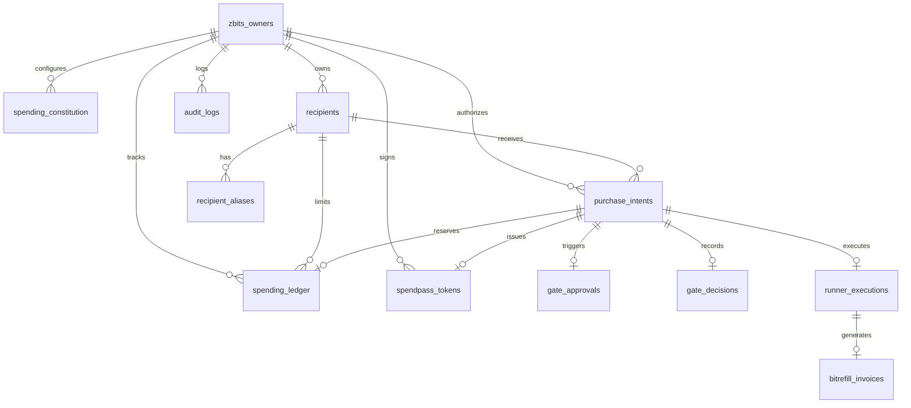

# Z-Bits: Database Architecture & Multi-Agent Financial Persistence

## 1. Executive Summary

Z-Bits uses a **Dual-Engine Persistence Architecture** engineered to guarantee high performance, local-first privacy, and bulletproof financial determinism:

1. **Local Agent Memory & Conversation Store (SQLite / OpenBot):** Preserves 100% of upstream Sidemates chat sessions, LLM agent configurations, vector search embeddings, and scratchpads without regression.
2. **Deterministic Financial & Authorization Store (Render Managed PostgreSQL 16):** An ACID-compliant, version-migrated relational layer backing **Gate**, **SpendPass**, **Runner**, **Zcash Privacy**, and the **Shared Recipient Ledger**.

When `DATABASE_URL` is configured, Z-Bits automatically executes versioned migrations and routes all multi-agent spending, alias resolution, token issuance, and execution auditing through PostgreSQL with row-level pessimistic locking (`SELECT ... FOR UPDATE`). When unset, Z-Bits operates in zero-config local mode.

---

## 2. Entity-Relationship Model



---

## 3. Schema Catalog (14 Production Tables)

| # | Table Name | Purpose | Concurrency / Integrity Controls |
|---|---|---|---|
| 1 | `schema_migrations` | Migration version tracking | Primary Key on `version`, atomic transactions |
| 2 | `zbits_owners` | Owner identities & multi-tenant isolation | UUID/String PK, `is_active` check |
| 3 | `spending_constitution` | Daily/monthly caps, emergency pause | Single active row per owner, row-level locking target |
| 4 | `recipients` | Canonical recipient identity and per-recipient limits | FK to `zbits_owners`, check `recipient_limit_cents >= 0` |
| 5 | `recipient_aliases` | Multi-agent nickname mapping (e.g. Rahul, rahul-s) | Unique composite index `(owner_id, normalized_alias)` |
| 6 | `purchase_intents` | Immutable purchase intent declarations | Unique `(owner_id, idempotency_key)`, SHA-256 digest |
| 7 | `spending_ledger` | Shared budget reservations and settlements | Status enum `('RESERVED', 'SETTLED', 'RELEASED')`, TTL expiry |
| 8 | `gate_approvals` | Human-in-the-loop owner approval queue | Status enum `('PENDING', 'APPROVED', 'REJECTED', 'EXPIRED')` |
| 9 | `gate_decisions` | Authorization audit decisions | Status enum `('ALLOW', 'DENY', 'REQUIRE_APPROVAL')`, JSONB reason codes |
| 10 | `spendpass_tokens` | Cryptographically signed, single-use tokens | Unique `jti`, status `('ISSUED', 'CLAIMED', 'CONSUMED', 'REVOKED', 'EXPIRED')` |
| 11 | `runner_executions` | Execution lifecycle & Bitrefill bridge | Status `('SUBMITTED', 'PENDING', 'SUCCESS', 'FAILED', 'UNCERTAIN')` |
| 12 | `bitrefill_invoices` | Bitrefill invoice tracking & delivery | Payment method enum, masked claim code storage |
| 13 | `bounty_events` | Bolt contributor rewards | Idempotency key uniqueness, status enum |
| 14 | `zcash_transactions` | Shielded Zcash payments & on-chain verification | Unique `txid`, opaque memo ref `zbits:ord_...` |
| 15 | `audit_logs` | Append-only security audit trail | Immutable sequence, JSONB metadata, indexed by action & target |

---

## 4. Concurrency & Atomicity: Budget Reservation Mechanics

To guarantee that independent agents (e.g. **Maya** Concierge and **Bolt** Bounty) cannot exceed daily or monthly spending limits when submitting concurrent purchase requests, Z-Bits implements pessimistic row-level locking:

```typescript
// 1. Begin atomic transaction
await client.query("BEGIN");

// 2. Lock the owner's constitution record with SELECT ... FOR UPDATE
const constRes = await client.query(
  "SELECT * FROM spending_constitution WHERE owner_id = $1 FOR UPDATE",
  [ownerId]
);

// 3. Evaluate cumulative spend (settled + active unexpired reservations)
const spendRes = await client.query(
  `SELECT
     COALESCE(SUM(CASE WHEN created_at >= $3 THEN amount_cents ELSE 0 END), 0) AS daily_spent,
     COALESCE(SUM(CASE WHEN created_at >= $4 THEN amount_cents ELSE 0 END), 0) AS monthly_spent,
     COALESCE(SUM(CASE WHEN recipient_id = $2 THEN amount_cents ELSE 0 END), 0) AS recipient_spent
   FROM spending_ledger
   WHERE owner_id = $1
     AND (status = 'SETTLED' OR (status = 'RESERVED' AND expires_at > now()))`,
  [ownerId, recipientId, todayStart, monthStart]
);

// 4. Deterministic limit verification
if (dailySpent + amountCents > constitution.daily_limit_cents) {
  throw new Error("Budget reservation rejected: would exceed daily spending limit.");
}

// 5. Insert reservation and commit transaction atomically
await client.query(
  "INSERT INTO spending_ledger (id, owner_id, status, expires_at, ...) VALUES (...)"
);
await client.query("COMMIT");
```

### Safety Guarantees:
1. **No Oversubscription:** Parallel agent queries queue on the row lock; the second agent immediately evaluates the first agent's reserved funds before approving.
2. **Automatic TTL Expiration:** Orphaned reservations expire after 15 minutes and cease counting against available budget without manual cleanup.
3. **Uncertain Order Protection:** Network timeouts or gateway failures mark orders as `UNCERTAIN` and preserve the budget reservation, preventing accidental double-spending.

---

## 5. Owner Isolation Model

Every entity table contains an `owner_id` column indexed with foreign key constraints:
- **Tenant Scope:** All repository queries require `ownerId` parameter (defaulting to `"local-owner"` in single-user mode).
- **Cross-Account Leakage Prevention:** Aliases and recipients created by `owner-alice` cannot be resolved or accessed by `owner-bob`.
- **Fail-Closed Alias Lookup:** If an ambiguous nickname matches multiple records, the lookup aborts and returns `null`.

---

## 6. Connection Management & Render Configuration

Connection pooling is handled via `PostgresPoolManager` (`pg.Pool`):
- **Dynamic Pool Size:** Configurable via `DATABASE_MAX_CONNECTIONS` (default: 20).
- **Timeouts:** `DATABASE_CONNECTION_TIMEOUT_MS` (5000ms), `DATABASE_IDLE_TIMEOUT_MS` (30000ms).
- **SSL Configuration:** Render PostgreSQL requires SSL encryption. When connecting to Render internal or external connection strings, `rejectUnauthorized: false` is enforced while preserving transport encryption.
- **Graceful Shutdown:** Process signals (`SIGINT`, `SIGTERM`) drain active pool connections within 5 seconds before terminating.

---

## 7. Health & Readiness API

| Endpoint | HTTP Method | Response Codes | Description |
|---|---|---|---|
| `/api/healthz` | `GET` | 200, 503 | Liveness probe returning application and database health |
| `/api/readyz` | `GET` | 200, 503 | Kubernetes / Render readiness probe verifying migration status |
| `/api/db/status` | `GET` | 200 | Diagnostic status reporting active engine, pool statistics, and latency |
