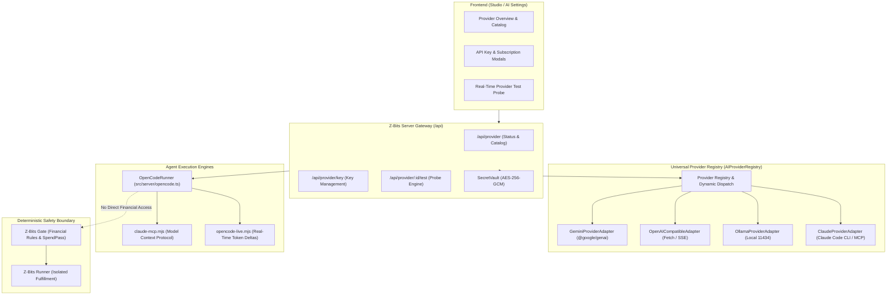

# Z-Bits — AI Provider Architecture & Integration Guide

**Document Version:** 1.0.0  
**Phase:** Phase 02 — AI Provider Integration & Reliability  
**Date:** 4 November 2026  
**Status:** VALIDATED  
**Architecture Principle:** Universal, Multi-Provider, Zero-Leakage, Deterministic Isolation

---

## 1. Architectural Overview

Z-Bits uses a **dual-tier AI provider layer** that bridges modern native SDKs and established external agent CLIs, giving agents access to diverse intelligence engines without vendor lock-in:



---

## 2. Implemented Provider Matrix

| Provider | Runtime Mode | Authentication | Streaming Protocol | Tool / Function Calling | Test Status |
|---|---|---|---|---|---|
| **Google Gemini** | Native SDK (`@google/genai`) + OpenCode CLI bridge | API Key (`GEMINI_API_KEY` / `OPENBOT_MODEL_API_KEY`) | `generateContentStream` with `textDelta` & `toolCallDelta` | Native `functionDeclarations` with JSON schema arguments | **PASS** (Unit/Mocks) / **BLOCKED** (Live: Needs User API Key) |
| **Anthropic Claude** | `claude_code` CLI (`2.1.193`) + MCP Bridge | `claude auth login` / Subscription / `ANTHROPIC_API_KEY` | CLI `--output-format stream-json` | MCP Stdio Protocol (`claude-mcp.mjs`, 90+ tools) | **PASS** (CLI detected/logged in; Live failed 403 quota) |
| **OpenAI-Compatible** | Direct HTTP / SSE Client | `Authorization: Bearer <key>` | Server-Sent Events (`text/event-stream`, `[DONE]`) | OpenAI tool format (`type: "function"`) | **PASS** (Unit/Mocks) / **READY** (Configurable) |
| **OpenCode** | External Agent CLI (`1.18.31`) | `opencode auth login` / `opencode auth list` | `opencode-live.mjs` stream watcher | Native OpenCode tools + custom tools | **PASS** (Unit/CLI Probe; Live free models restricted by upstream) |
| **Ollama (Local)** | Local HTTP endpoint (`127.0.0.1:11434/v1`) | None required for localhost (`isLocalModelUrl`) | Standard OpenAI SSE stream | Function calling on supported models (e.g. `llama3.1`, `qwen2.5-coder`) | **PASS** (Unit) / **BLOCKED** (Daemon not running locally) |
| **AWS Bedrock** | Native SDK (`@aws-sdk/client-bedrock-runtime`) | IAM Access Key / Secret / Session Token | Converse Stream API | Native Converse Tool Specifications | **PRESERVED SKELETON** (Deferred; No modifications per Phase 02 rules) |

---

## 3. Provider Registration & Lifecycle

### 3.1 Registry Architecture
All direct adapters implement the unified `AIProviderAdapter` interface defined in `src/server/providers/provider-registry.ts`:

```typescript
export interface AIProviderAdapter {
  id: string;
  name: string;
  supportsTools: boolean;
  supportsStreaming: boolean;
  validateConfiguration(config?: unknown): Promise<ProviderValidationResult>;
  listModels?(): Promise<string[]>;
  generateResponse(request: AIRequest): Promise<AIResponse>;
  streamResponse?(request: AIRequest): AsyncIterable<AIStreamChunk>;
}
```

The singleton `AIProviderRegistry` manages registration, retrieval, and runtime inspection:
- `register(adapter: AIProviderAdapter)`: Stores adapter by ID.
- `getAdapter(id: string)`: Retrieves adapter instance.
- `has(id: string)`: Fast existence check.
- `list()`: Returns all active registered adapters.
- `count()`: Returns current count.
- `resetForTesting()`: Cleans up state between hermetic unit test runs.

---

## 4. Model Selection & Routing

Model routing is implemented in `src/server/ai-router.ts`. The router dynamically matches agent tasks to the optimal available AI without requiring users to manually select models for every prompt.

### 4.1 Job Classification
The engine classifies prompts into two tiers via `classifyJob`:
- **Light (`"light"`):** Short prompts (< 280 chars), single-turn queries, non-browser tasks. Routed to fast, low-cost models (`gemini-flash-lite`, `gpt-4o-mini`, `claude-3-5-haiku`).
- **Heavy (`"heavy"`):** Prompts with research keywords, attachments, routine executions, multi-step reports (> 120 chars). Routed to reasoning/frontier models (`gemini-2.5-pro`, `gpt-4o`, `claude-3-5-sonnet`).

### 4.2 Priority Ranking
Connections are ranked according to task tier:
- **Heavy Jobs:** `["claude", "bedrock", "openai", "google", "gemini", "github-copilot", "xai", "opencode", "openai-compatible", "gitlab", "custom", "apple"]`
- **Light Jobs:** `["claude", "bedrock", "openai", "google", "gemini", "opencode", "github-copilot", "xai", "openai-compatible", "custom", "gitlab", "apple"]`

### 4.3 Quota Awareness & Error Rest
When a provider encounters rate limits (`429`), quota exhaustion, or credit depletion, `isLimitError` identifies the failure and `AiRest` temporarily rests the connection (default: 60 minutes). The router immediately hands the job off to the next connected provider without failing the user's task or corrupting conversation state.

Patterns caught by `isLimitError`:
`429`, `rate limit`, `usage limit`, `quota`, `insufficient_quota`, `insufficient credit`, `out of credits`, `weekly allowance`, `resource_exhausted`, `overloaded`, `额度不足`.

---

## 5. Security & Secret Protection

1. **Zero Client Leakage:** Provider secrets (`GEMINI_API_KEY`, `OPENAI_API_KEY`, Anthropic tokens) are strictly stored in `SecretVault` (`src/server/vault.ts`) with AES-256-GCM encryption on disk.
2. **Sanitized Probing:** The `/api/provider/:id/test` endpoint probes models using an isolated single-token prompt (`PROBE_TOKEN = "OPENBOT_OK"`). Errors are normalized via `safeProbeError()`, stripping raw stack traces, API keys, URLs, and authorization headers.
3. **No Financial Privileges:** AI models are explicitly prohibited from making direct financial decisions or purchasing items. All commerce intent is passed to the deterministic **Z-Bits Gate** for budget and policy verification.
