# Z-Bits Runner Architecture Specification

**Product:** Z-Bits (*"Your agents. Your rules. Your money."*)  
**Component:** Runner (Deterministic Purchase Execution Service)  
**Status:** IMPLEMENTED (Phase 05)  
**Integration Partner:** Bitrefill Commerce API  

---

## 1. Executive Architectural Summary

**Runner** is the deterministic, non-LLM purchase execution service of Z-Bits. Its sole responsibility is to translate Gate-authorized financial permissions into real-world merchant purchases.

```
+---------------+     PurchaseIntent     +----------------+     Signed SpendPass     +------------------+
|   AI Agent    | ---------------------> |      GATE      | -----------------------> |      RUNNER      |
| (Nova / Bolt) |                        | (Deterministic |                          | (Deterministic   |
+---------------+                        |  Constitution) |                          |  Merchant Exec)  |
                                         +----------------+                          +------------------+
                                                                                              |
                                                                                  REST Orders | Polling
                                                                                              v
                                                                                     +------------------+
                                                                                     |    Bitrefill     |
                                                                                     |   Commerce API   |
                                                                                     +------------------+
```

### Core Invariants

1. **Zero LLM Authority:** Runner contains zero LLM decision-making loops or natural-language heuristics. All validations, state transitions, and merchant calls execute purely deterministic TypeScript logic.
2. **Fail-Closed SpendPass Verification:** Runner never interacts with an external merchant unless presented with a cryptographically valid, unconsumed, unrevoked SpendPass token.
3. **Exact Scope Enforcement:** Product ID, denomination, currency, recipient identity, and price ceiling are strictly matched against the signed claims in the token.
4. **Atomic Claim Transition (`ISSUED -> CLAIMED`):** Replay and concurrent execution races are eliminated by SQLite-serialized atomic state transition before any outbound network call.
5. **Delivery Verification (`Paid != Delivered`):** Payment confirmation does not constitute fulfillment. Runner polls merchant invoice status until terminal `delivered` status is achieved.
6. **Post-Delivery Ledger Settlement:** Gate reservation funds are settled and SpendPass state advances to `CONSUMED` strictly after confirmed delivery.
7. **Uncertain-Outcome Resilience:** In the event of network timeouts or dropped connections during order submission or polling, the execution state is safely transitioned to `UNCERTAIN` and funds remain reserved (never released blindly or double-spent).

---

## 2. Complete Execution Lifecycle State Machine

```mermaid
stateDiagram-v2
    [*] --> ISSUED : Gate evaluates & issues SpendPass
    ISSUED --> CLAIMED : Runner pre-flight checks pass & claimSpendPass()
    ISSUED --> FAILED : Pre-flight check fails (tampered, expired, scope mismatch)
    
    CLAIMED --> IN_FLIGHT : Outbound Bitrefill POST /orders
    IN_FLIGHT --> DELIVERING : Order accepted; Invoice created (pending/delivering)
    IN_FLIGHT --> UNCERTAIN : Network timeout / connection dropped (ETIMEDOUT)
    IN_FLIGHT --> FAILED : Merchant rejected (out of stock / invalid denom)
    
    DELIVERING --> DELIVERED : Polling verifies status == 'delivered'
    DELIVERING --> FAILED : Merchant reports terminal failure
    DELIVERING --> UNCERTAIN : Polling deadline reached before terminal state
    
    DELIVERED --> CONSUMED : Gate completeSpendPass() & settle spending_ledger
    CONSUMED --> [*]
    
    UNCERTAIN --> [*] : Requires operator reconciliation (ledger held safe)
    FAILED --> [*] : Ledger released; funds unlocked
```



---

## 3. Component Architecture & Class Structure

### 3.1 `BitrefillClient` (`src/server/runner/bitrefill-client.ts`)
- **Transport:** Native `fetch` with HMAC/Basic authorization headers.
- **Methods:**
  - `isConfigured(): boolean`: Checks for live credentials (`BITREFILL_API_KEY`, `BITREFILL_API_SECRET`).
  - `searchProducts(query?, country?): Promise<BitrefillProduct[]>`: Discovers available gift cards, vouchers, and utility top-ups.
  - `getProductDetails(productId): Promise<BitrefillProduct | null>`: Fetches package tiers, price ranges, and real-time inventory availability.
  - `createOrder(params): Promise<BitrefillOrderResult>`: Submits authenticated purchase orders.
  - `getInvoice(invoiceId): Promise<BitrefillInvoiceResult>`: Queries current invoice and delivery state.
  - `maskSensitiveCode(code): string`: Ensures raw gift-card codes are masked before logging or persistence (`ABCD-****-****-1234`).
- **Sandbox Fallback:** When live API credentials are unset or running in test mode (`process.env.NODE_ENV === "test"`), seamlessly routes requests to high-fidelity in-memory catalog simulation.

### 3.2 `CommerceRunner` (`src/server/runner/commerce-runner.ts`)
- **Verification Engine:** Calls `GateEngine.verifySpendPass(token, execContext)` before any network action.
- **Claim Manager:** Invokes `GateEngine.claimSpendPass(spendpassId, executionId)` to transition token state atomically.
- **Order Dispatcher:** Executes merchant purchase via `BitrefillClient`.
- **Delivery Poller:** Executes bounded polling loop (`pollInvoiceDelivery`) checking for terminal `delivered` state.
- **Settlement Coordinator:** Invokes `GateEngine.completeSpendPass(spendpassId, executionId)` to settle the reservation in `spending_ledger` and mark token `CONSUMED`.
- **Audit Logger:** Dispatches structured audit events (`runner_purchase_initiated`, `runner_delivery_confirmed`, `runner_settlement_completed`, `runner_purchase_uncertain`, `runner_execution_blocked`) to `GateEngine.recordAudit()`.

---

## 4. Database Schema Additions

Runner persists execution records and merchant invoices in SQLite (`src/server/database.ts`):

### Table: `runner_executions`
```sql
CREATE TABLE IF NOT EXISTS runner_executions (
  id TEXT PRIMARY KEY,
  spendpass_id TEXT NOT NULL REFERENCES spendpass_tokens(id) ON DELETE CASCADE,
  purchase_intent_id TEXT NOT NULL REFERENCES purchase_intents(id) ON DELETE CASCADE,
  owner_id TEXT NOT NULL REFERENCES users(id) ON DELETE CASCADE,
  merchant TEXT NOT NULL,
  status TEXT NOT NULL DEFAULT 'IN_FLIGHT',  -- 'IN_FLIGHT' | 'COMPLETED' | 'FAILED' | 'UNCERTAIN'
  actual_amount_cents INTEGER NOT NULL,
  currency TEXT NOT NULL DEFAULT 'USD',
  invoice_id TEXT,
  merchant_invoice_id TEXT,
  delivery_status TEXT,
  delivery_ref TEXT,                       -- Masked claim code or reference
  delivered_at TEXT,
  error_message TEXT,
  reason_codes_json TEXT,
  created_at TEXT NOT NULL,
  updated_at TEXT NOT NULL
);
CREATE INDEX IF NOT EXISTS idx_runner_executions_spendpass ON runner_executions(spendpass_id);
```

### Table: `runner_invoices`
```sql
CREATE TABLE IF NOT EXISTS runner_invoices (
  id TEXT PRIMARY KEY,
  execution_id TEXT NOT NULL REFERENCES runner_executions(id) ON DELETE CASCADE,
  purchase_intent_id TEXT NOT NULL REFERENCES purchase_intents(id) ON DELETE CASCADE,
  spendpass_id TEXT NOT NULL REFERENCES spendpass_tokens(id) ON DELETE CASCADE,
  owner_id TEXT NOT NULL REFERENCES users(id) ON DELETE CASCADE,
  merchant TEXT NOT NULL,
  merchant_invoice_id TEXT UNIQUE NOT NULL,
  merchant_order_id TEXT,
  product_id TEXT NOT NULL,
  denomination INTEGER NOT NULL,
  currency TEXT NOT NULL DEFAULT 'USD',
  actual_amount_cents INTEGER NOT NULL,
  status TEXT NOT NULL DEFAULT 'CREATED',    -- 'CREATED' | 'PENDING' | 'PAID' | 'DELIVERED' | 'FAILED' | 'UNCERTAIN'
  merchant_status TEXT NOT NULL,
  delivery_ref TEXT,                         -- Masked claim code
  delivered_at TEXT,
  error_message TEXT,
  created_at TEXT NOT NULL,
  updated_at TEXT NOT NULL
);
CREATE INDEX IF NOT EXISTS idx_runner_invoices_merchant_inv ON runner_invoices(merchant_invoice_id);
```

---

## 5. REST API Interface Summary

| Endpoint | Method | Description |
|---|---|---|
| `/api/runner/integrations` | `GET` | Lists active commerce integration adapters (Bitrefill, Zcash). |
| `/api/runner/products` | `GET` | Product catalog discovery (`q`, `country`). |
| `/api/runner/products/:id` | `GET` | Product detail and denomination tier lookup. |
| `/api/runner/execute` | `POST` | Primary entrypoint: executes SpendPass-authorized purchase. |
| `/api/runner/executions` | `GET` | Lists execution audit history for the authenticated owner. |
| `/api/runner/executions/:id` | `GET` | Fetches details and status for a specific execution ID. |
| `/api/runner/invoices/:id` | `GET` | Fetches invoice and delivery status for an invoice ID. |
| `/api/runner/invoices/:id/poll` | `POST` | Triggers immediate delivery verification polling. |

---

## 6. Architectural Guarantees

1. **Replay Impossibility:** Once claimed, a SpendPass cannot be reclaimed by concurrent threads or subsequent requests.
2. **Price Slippage Immunity:** If merchant price changes between intent creation and execution, Runner rejects the order if `price > max_amount`.
3. **Zero Financial Drift:** Spending ledger reservation is never finalized until delivery is cryptographically/deterministically verified.
4. **Clean Decoupling:** AI agents possess zero knowledge of Bitrefill API keys, credentials, or gift-card generation logic.
