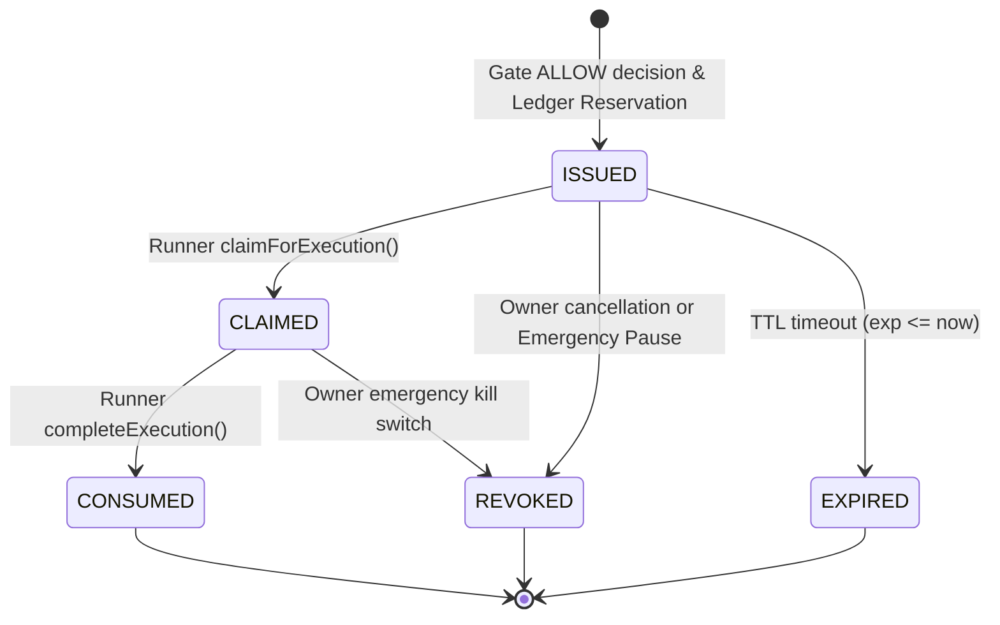

# Z-Bits SpendPass: Signed Purchase Authorization System Architecture

> **Tagline:** Your agents. Your rules. Your money.  
> **Core Principle:** An authorized purchase can only be executed for the approved recipient, merchant, product, denomination, and amount, within the approved validity window, and **exactly once**.

---

## 1. Executive Summary

**SpendPass** is the cryptographic single-use authorization token system connecting **Gate** (the deterministic financial authorization service) with **Runner** (the non-custodial purchase execution service).

In Z-Bits, AI teammates (Maya, Bolt, Sage) never possess payment credentials, private keys, or direct balance access. When Gate deterministically evaluates a `PurchaseIntent` against the owner's Spending Constitution, enforces multi-agent budget caps, and confirms policy compliance, Gate issues a cryptographically signed **SpendPass**.

Runner validates the SpendPass with Gate before and during checkout execution. Without a valid, unconsumed, unrevoked SpendPass matching the exact merchant, recipient, product, denomination, and price parameters, Runner **fails closed** and refuses to dispatch payment.

```
+-----------------------------------------------------------------------------------+
|                           AI Teammates (Maya, Bolt, Sage)                         |
|                    Formulate PurchaseIntent (Never hold money)                    |
+-----------------------------------------------------------------------------------+
                                          |
                                          | POST /api/gate/evaluate
                                          v
+-----------------------------------------------------------------------------------+
|                        Z-BITS GATE (Deterministic Engine)                         |
|  1. Evaluates Spending Constitution limits & cumulative budgets                   |
|  2. Atomically locks funds in spending_ledger (status: 'RESERVED')                |
|  3. Produces ALLOW decision                                                       |
|  4. Issues cryptographically signed SpendPass JWT token                           |
+-----------------------------------------------------------------------------------+
                                          |
                                          | spendpassToken (Compact JWT)
                                          v
+-----------------------------------------------------------------------------------+
|                        Z-BITS RUNNER (Purchase Dispatcher)                        |
|  1. Receives SpendPass token                                                      |
|  2. Calls /api/gate/spendpass/verify with checkout context                        |
|  3. Atomically claims token: /api/gate/spendpass/claim (ISSUED -> CLAIMED)        |
|  4. Dispatches merchant/crypto transaction (Bitrefill / Zcash)                    |
|  5. Atomically consumes token: /api/gate/spendpass/consume (CLAIMED -> CONSUMED)  |
|  6. Settles budget reservation in spending_ledger (RESERVED -> SETTLED)           |
+-----------------------------------------------------------------------------------+
```

---

## 2. SpendPass Token Specifications

SpendPass is constructed as an **RFC 7519 Compact JSON Web Token (JWT)** composed of three base64url-encoded parts separated by periods: `header.payload.signature`.

### 2.1 Header Schema

```json
{
  "alg": "HS256",
  "typ": "JWT",
  "kid": "k1"
}
```

- **`alg`**: Fixed allowlisted algorithm: `HS256` (HMAC using SHA-256). Any other algorithm (including `"none"` or asymmetric confusion attacks) is rejected.
- **`typ`**: Fixed value `"JWT"`.
- **`kid`**: Active Key Identifier used for signature generation and seamless key rotation.

### 2.2 Payload Claims Schema

| Field | Type | Description |
| :--- | :--- | :--- |
| `iss` | `string` | Fixed issuer identity: `"zbits-gate-authority"`. |
| `aud` | `string` | Fixed audience: `"zbits-runner-executor"`. |
| `jti` | `string` | Unique token identifier (`sp_<24-hex-chars>`), serving as the primary key. |
| `sub` | `string` | Canonical owner ID (`"local-owner"`). |
| `agent_id` | `string` | Requesting AI agent ID (`"nova"` / Maya / Bolt / Sage). |
| `purchase_intent_id` | `string` | The approved `PurchaseIntent` ID. |
| `authorization_id` | `string` | The cryptographic authorization event ID. |
| `reservation_id` | `string` | The active `spending_ledger` reservation entry ID. |
| `recipient_id` | `string` | The canonical recipient ID (`"rec_self"`, `"rec_alice"`). |
| `merchant_id` | `string` | Authorized merchant ID (normalized lowercase, e.g., `"bitrefill"`). |
| `product_id` | `string?` | Specific product/item identifier, if restricted. |
| `denomination` | `number` | Authorized purchase denomination in minor units (cents). |
| `currency` | `string` | ISO 4217 currency code (`"USD"`). |
| `max_amount` | `number` | Strictly immutable upper bound on actual checkout price (cents). |
| `policy_version` | `number` | Spending Constitution policy version at time of approval. |
| `iat` | `number` | Issued At timestamp (Unix epoch seconds). |
| `nbf` | `number` | Not Before timestamp (Unix epoch seconds). |
| `exp` | `number` | Expiration timestamp (Unix epoch seconds, default: `iat + 900`). |
| `nonce` | `string` | High-entropy cryptographic random nonce preventing rainbow collisions. |

---

## 3. Persistent State Machine & Atomic Transitions

SpendPass tokens are persisted in the local SQLite table `spendpass_tokens` with strict foreign key constraints and serialized atomic lifecycle states:



### 3.1 State Definitions

1. **`ISSUED`**: The token has been generated and signed by Gate. An active reservation of `max_amount` exists in `spending_ledger`. The token is eligible for execution.
2. **`CLAIMED`**: Runner has locked the token for active checkout. The `execution_id` is bound to the record. No other runner instance or concurrent thread can claim this token (replay attack blocked).
3. **`CONSUMED`**: The purchase has been confirmed and paid. The budget reservation is settled (`SETTLED`) in `spending_ledger`. The token can never be reused.
4. **`REVOKED`**: The owner or Gate has revoked the token (e.g. manual revocation, emergency pause). The budget reservation is released (`RELEASED`).
5. **`EXPIRED`**: The token was not claimed or consumed within its validity window (`exp <= now`).
6. **`RECONCILIATION_REQUIRED`**: Flags an operational state requiring audit inspection.

### 3.2 Serialized Concurrency Guarantee

All state transitions (`claimSpendPassToken`, `consumeSpendPassToken`, `revokeSpendPassToken`) are executed inside SQLite `BEGIN IMMEDIATE ... COMMIT` transactions on the main database connection. 

This guarantees:
- Concurrent attempts to claim the same token serialize at the database level.
- Exactly one claim succeeds; all other concurrent workers receive `false` and fail closed.
- Eliminates TOCTOU (Time-of-Check to Time-of-Use) race conditions.

---

## 4. Runner Verification Pipeline

Before initiating any external checkout API call, Runner calls `verifySpendPass(token, executionContext)`:

1. **Structural Check**: Must be a valid 3-segment compact JWT string.
2. **Header & Algorithm Validation**: `alg === "HS256"` (rejects `none` or other algorithms).
3. **Key Identification**: Identifies `kid` and verifies secret availability in key map.
4. **Cryptographic Integrity**: Computes HMAC-SHA256 over `${headerB64}.${payloadB64}` and validates against the token signature using timing-safe comparison (`crypto.timingSafeEqual`).
5. **Issuer & Audience**: Validates `iss === "zbits-gate-authority"` and `aud === "zbits-runner-executor"`.
6. **Temporal Validity**: Validates `nbf <= now` and `exp > now`.
7. **Emergency Pause Precedence**: Verifies that the owner's constitution does not have `emergency_pause = 1`. If paused, verification fails immediately with `EMERGENCY_PAUSE_ACTIVE`.
8. **Persistent Record Status**: Queries SQLite by `jti`. Token must exist and be in `ISSUED` status (or `CLAIMED` if matching the same `executionId`).
9. **Budget Reservation Consistency**: Queries `spending_ledger` by `reservationId`. The reservation must exist and be in `RESERVED` status.
10. **Scope Binding Match**:
    - `recipientId` matches token recipient.
    - `merchantId` matches token merchant (case-insensitive).
    - `productId` matches token product if specified.
    - `denomination` matches token denomination.
    - `currency` matches token currency.
    - `actualAmountCents <= max_amount` (price increase rejected).
